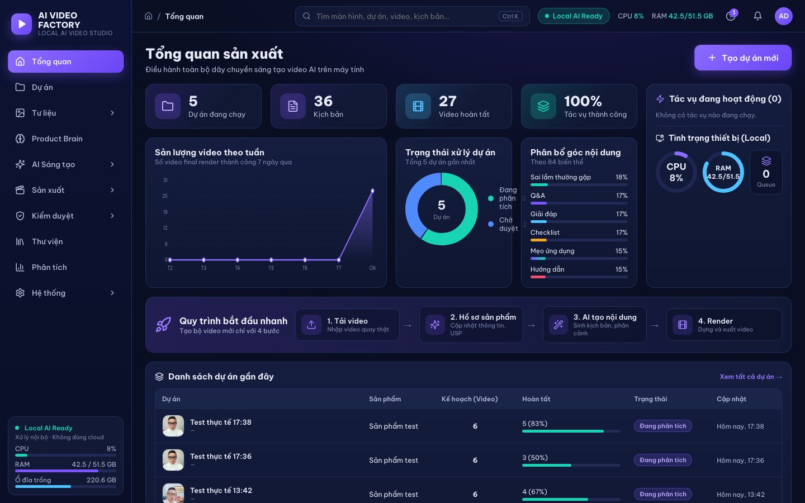
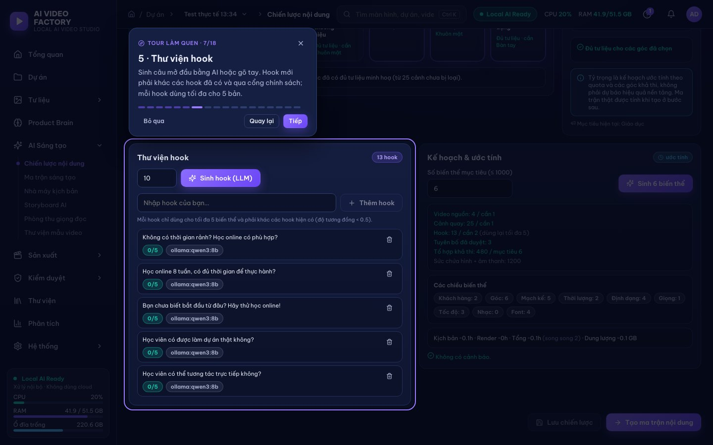
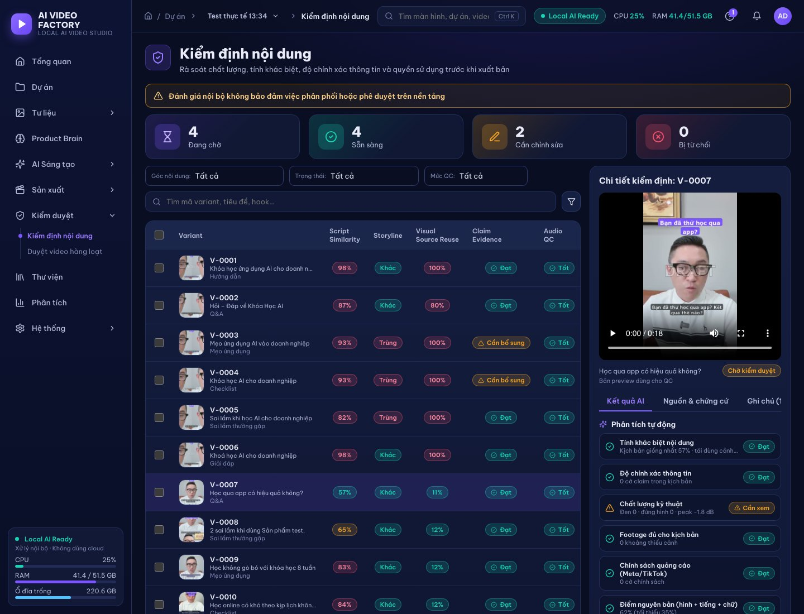
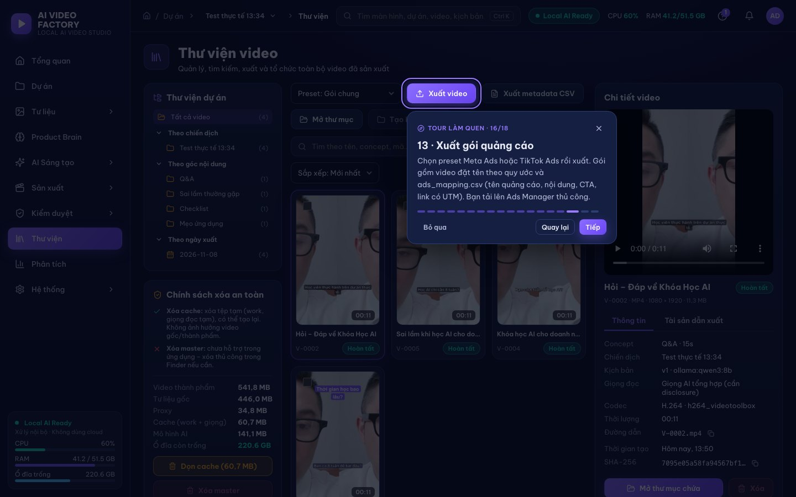
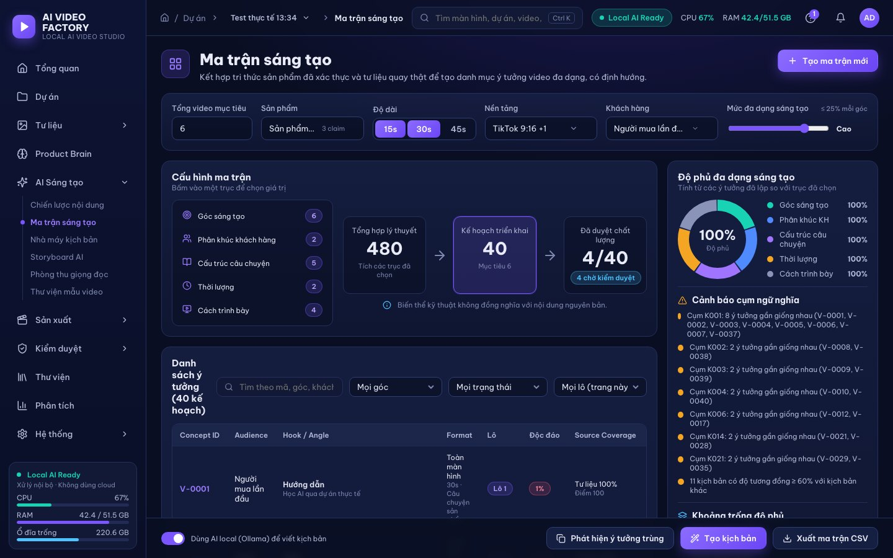
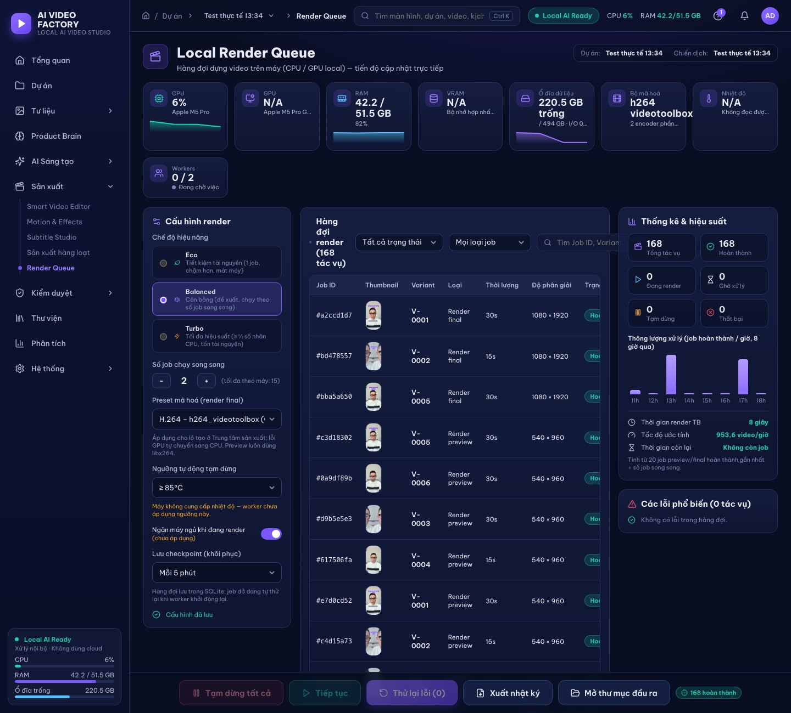
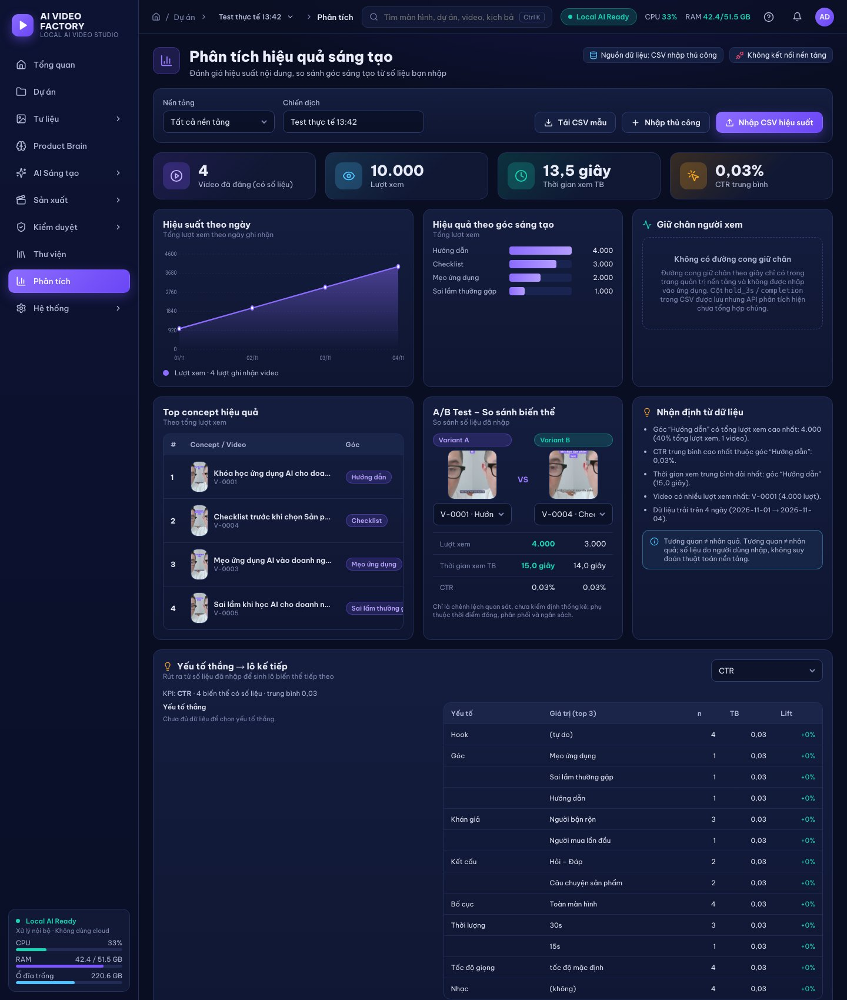

# AI Video Factory

Ứng dụng local-first: từ video quay thật + hồ sơ sản phẩm có bằng chứng → lập kế hoạch, viết kịch bản, dựng,
kiểm duyệt và render nhiều biến thể video ngay trên máy. Xây theo bản đặc tả
`AI_VIDEO_FACTORY_DAC_TA_VIBE_CODING_FULL.docx` (v1.0) và 24 ảnh giao diện tham chiếu `AVF_01–24`.

> Hệ thống tách **render thành công** và **được duyệt sáng tạo**. Không có chức năng né fingerprint/bộ lọc trùng lặp,
> không bảo đảm nền tảng chấp thuận, không tự đăng hàng loạt.



**[📖 Hướng dẫn sử dụng chi tiết có ảnh minh hoạ → docs/HUONG_DAN.md](docs/HUONG_DAN.md)**

Lần đầu mở app, một **tour làm quen** tự chạy qua toàn bộ quy trình; nút **?** trên thanh trên cùng mở lại tour,
hướng dẫn riêng từng màn và checklist tiến độ của dự án.

| Thư viện hook + kế hoạch | Kiểm định QC (claim · chính sách · nguyên bản) | Xuất gói Ads Manager |
|---|---|---|
|  |  |  |
| **Ma trận biến thể theo lô** | **Hàng đợi render bền vững** | **Yếu tố thắng → lô kế tiếp** |
|  |  |  |

## Chạy

Yêu cầu: Python 3.11+, Node 18+, FFmpeg/ffprobe trong PATH. Tuỳ chọn: Ollama (LLM), whisper-cli (ASR), tesseract (OCR).

```bash
./scripts/dev.sh          # API 127.0.0.1:8765 + worker + giao diện dev http://127.0.0.1:5190
./scripts/start.sh        # build giao diện rồi chạy tất cả tại http://127.0.0.1:8765
.venv/bin/python -I scripts/seed_demo.py   # (khi API + worker đang chạy) tạo dự án mẫu end-to-end
.venv/bin/python -m pytest                 # test unit + integration (render thật bằng ffmpeg)
.venv/bin/python -I scripts/smoke_real.py video1.mov video2.mp4 [--folder thư_mục]   # test toàn bộ tính năng với video thật
```

Linux: chạy `./scripts/install-linux.sh` một lần (kiểm tra máy, cài thư viện, giọng Piper tiếng Việt, whisper-cli, model AI — hỏi
trước khi tải phần lớn), sau đó `./scripts/start.sh`. Chi tiết và cấu hình cho máy RAM 16 GB: [CAI-DAT.md](CAI-DAT.md).

Windows (PowerShell): `.\scripts\dev.ps1` / `.\scripts\start.ps1` (cần Python 3.11+, Node 18+, ffmpeg trong PATH; giọng tiếng Việt
cài ở Settings → Speech). Mã đã rà soát cho Windows nhưng mới chạy thử thật trên macOS.

Hướng dẫn sử dụng: [docs/HUONG_DAN.md](docs/HUONG_DAN.md) (xem trực tiếp trên GitHub) hoặc bản HTML `docs/huong-dan/index.html`.
Chụp lại ảnh tài liệu: `scripts/capture_screens.py` (Chrome/Edge headless).

Biến môi trường: `AVF_DATA_DIR` (CSDL, media, cache), `AVF_OUTPUT_DIR` (video xuất), `AVF_OLLAMA_MODEL`
(mặc định `qwen3:8b`), `AVF_OLLAMA_NUM_CTX` (8192), `AVF_OLLAMA_KEEP_ALIVE` (3m), `AVF_RAM_PER_RENDER_GB` (4),
`AVF_MIN_FREE_RAM_GB` (1.5), `AVF_PORT`, `AVF_MIN_FREE_GB`.

## Ứng dụng desktop (Tauri 2)

```bash
cd apps/desktop && npm run build && npx tauri build --bundles app
# → apps/desktop/src-tauri/target/release/bundle/macos/AI Video Factory.app
```

App mở màn hình chờ, tự chạy API + worker từ thư mục dự án (`.venv`), đợi `/system/health` rồi mở giao diện;
đóng app sẽ tắt các tiến trình nó đã khởi động (dịch vụ chạy sẵn từ `dev.sh` được giữ nguyên).
Thư mục dự án tìm theo thứ tự: biến `AVF_ROOT` → file `~/Library/Application Support/AIVideoFactory/root.txt`
→ đường dẫn lúc build. Nếu di chuyển thư mục dự án, ghi đường dẫn mới vào `root.txt`.

## Quy mô 100–1000 creative và chính sách nền tảng

Mục tiêu của phần mềm là **nhiều creative khác nhau thật** từ một bộ nguồn, dùng chủ yếu cho quảng cáo
(Meta Ads Manager / TikTok Ads chấp nhận hàng trăm creative để test). Nó **không** nhân bản gần giống một video
và **không** có kỹ thuật né bộ lọc trùng lặp (lật, đổi tốc độ, nhiễu, xoá watermark), không đăng tự động, không đa tài khoản —
những thứ đó bị Meta (unoriginal content, 7/2025) và TikTok (unoriginal/duplicated, spam) giảm phân phối hoặc khoá.

| Cơ chế | Ở đâu | Làm gì |
|---|---|---|
| Cổng đa dạng nguồn | Sinh ma trận | >20 bản cần ≥3 video nguồn & 12 cảnh; >100 cần ≥5 & 25; >300 cần ≥8 & 40. Thiếu → `NEED_MORE_SOURCE` (brief `allow_low_source` để bỏ qua, có cảnh báo) |
| Thư viện hook | Chiến lược → Thư viện hook | LLM/mẫu sinh hook; hook mới phải khác mọi hook đã có (cosine < 0.5), qua claim gate + cổng chính sách; mỗi hook dùng tối đa 5 bản |
| Biến số hình/tiếng | Tự gán khi sinh biến thể | Bố cục full/split/pip/packshot (split/pip dùng **một cảnh khác**, không lặp cảnh chính), tốc độ giọng 0.92/1.0/1.08, font (chỉ font có glyph tiếng Việt), nhạc từ `data/music` (cần `LICENSE.txt`), cảnh ưu tiên cảnh chưa dùng ở bản khác |
| Điểm nguyên bản | QC → "Điểm nguyên bản" | 1 − độ giống tổng hợp (chữ 35% + hook 15% + hình 35% + tiếng 15%) với bản gần nhất. Dưới ngưỡng (`originality_min`, mặc định 0.35) → **chặn duyệt (BLOCK-04), chặn render final, loại khỏi gói xuất** |
| Cổng chính sách quảng cáo | Kịch bản + QC → "Chính sách" | 11 nhóm quy tắc theo ngành (trước/sau, cam kết kết quả, công dụng y khoa, giảm cân, đặc điểm cá nhân, so sánh nhất, khan hiếm giả, giá/ưu đãi, testimonial, tài chính, rượu/thuốc lá). Critical → kịch bản `blocked`, QC fail không waive được (BLOCK-05) |
| Vùng an toàn TikTok | Render + QC | Chữ tự thu/đẩy khỏi đáy 26% và cột phải 14%; QC đếm khối chữ còn chạm |
| Kế hoạch & ước tính | Chiến lược → Kế hoạch | Yêu cầu nguồn/hook/claim, tổ hợp khả thi, giờ LLM + render (đo từ job đã chạy), dung lượng |
| Lô lớn | Ma trận / Hàng đợi | Sinh thêm lô (`new_batch`), mã tiếp nối, tạm dừng/tiếp tục/huỷ cả lô, phân trang |
| Gói Ads Manager | Thư viện → Xuất | Preset Meta/TikTok: tên file theo quy ước, `ads_mapping.csv` (ad_name, primary_text, headline, CTA, landing_url + UTM theo mã), kiểm tra spec (thời lượng, tỷ lệ, dung lượng, UI TikTok), `README.txt`. Tải lên thủ công |
| Yếu tố thắng → lô kế tiếp | Phân tích | Nhập CSV kết quả → lift theo hook/góc/khán giả/kết cấu/bố cục/thời lượng/giọng/nhạc (n≥2) → ma trận có trọng số + hook thắng ưu tiên + % hook mới |

## Kiến trúc

```
apps/desktop/            React 18 + TypeScript + Vite — 24 màn hình theo ảnh tham chiếu
  src/components/Tour.tsx  tutorial: tour làm quen, hướng dẫn theo màn, checklist (nội dung ở src/lib/tour.ts)
services/api/avf/
  main.py                FastAPI, chỉ bind 127.0.0.1, lỗi {code,message,details,retryable,hint,trace_id}
  db.py                  SQLite WAL + migration có version (bảng theo mục 5 SRS)
  media.py               ffprobe, proxy, keyframe, waveform, scene detect, chất lượng, OCR, ASR
  creative.py            ma trận biến thể, claim gate, độ tương đồng/cụm, kịch bản, storyboard
  ai.py                  client Ollama: JSON output + validate + retry → fallback template engine
  tts.py                 TTS local (macOS `say`/Windows SAPI/Linux Piper + espeak-ng), lexicon đọc số/đơn vị, loudnorm, cache
  render.py              timeline JSON → FFmpeg: motion, phụ đề/tiêu đề (Pillow), mix giọng, DRAFT, xuất atomic
  pipeline.py            nghiệp vụ A–D + state machine biến thể + QC + duyệt
  scale.py               hook, cổng nguồn, biến số hình/tiếng, điểm nguyên bản, ước tính, yếu tố thắng → lô kế tiếp
  policy.py              cổng chính sách quảng cáo Meta/TikTok theo ngành + vùng UI TikTok
  worker.py              hàng đợi bền vững: claim nguyên tử, heartbeat, retry backoff, pause/resume, crash recovery
packages/contracts/      JSON schema timeline (avf.timeline/1)
tests/                   unit + integration (vertical slice import → final export)
```

Luồng: Nhập nguồn → Phân tích (cảnh, keyframe, OCR, ASR) → Product Brain (claim + bằng chứng) → Chiến lược
→ Ma trận → Kịch bản (LLM có claim gate) → Duyệt → Storyboard → Giọng đọc → Preview (DRAFT) → QC → Duyệt
(chỉ Reviewer/Owner) → Render final → Thư viện/Export (MP4 + SRT + JPG + manifest JSON/CSV).

## Thật / giới hạn

| Tính năng | Trạng thái |
|---|---|
| Import, SHA-256 chống trùng, ffprobe, rotation, proxy, keyframe, waveform | Chạy thật |
| Scene detect (ffmpeg), chất lượng sáng/rung, clipping/im lặng | Chạy thật |
| Gắn nhãn shot | Heuristic, confidence 0.45 — **người dùng phải xác nhận** |
| OCR | Tesseract; máy hiện chỉ có gói `eng` (cần `vie.traineddata` cho tiếng Việt) |
| ASR tiếng Việt | whisper.cpp + `ggml-base` (tải ở màn Quản lý mô hình AI); video 51 giây xử lý ~20 giây. Model base hay sai tên riêng — thả `ggml-small.bin`/`ggml-medium.bin` vào `data/models` thì app tự dùng model lớn nhất |
| Kịch bản | Ollama qwen3:8b thật; claim gate bắt sinh lại, sau đó dùng template engine (chỉ ghép dữ liệu đã duyệt) |
| Claim gate | Chặn claim chưa duyệt/bị cấm, cụm từ rủi ro, câu không khớp claim được trích; cảnh báo câu lợi ích không trích dẫn |
| Độ tương đồng / nguyên bản | Cosine unigram+bigram cho chữ; hình theo cảnh/bố cục/font; tiếng theo giọng/tốc độ/nhạc. Chưa dùng embedding hay perceptual hash khung hình |
| TTS | Giọng hệ điều hành (macOS "Linh", Windows SAPI) × 3 tốc độ; Linux: Piper neural tiếng Việt (`vi_VN-vais1000-medium`), dự phòng espeak-ng; giọng nhái/10 giọng có sẵn qua VieNeu (`setup-voice.sh`) |
| Render | FFmpeg thật; motion zoom/pan; bố cục full/split/pip/packshot; logo + thẻ kết thương hiệu; GPU VideoToolbox/NVENC tự fallback CPU |
| Nhạc nền + ducking | Thả file vào `data/music` kèm `LICENSE.txt`; app xoay vòng nhạc theo biến thể và duck dưới giọng. Không kèm nhạc sẵn |
| GPU %/VRAM/nhiệt độ | Không đọc được trên macOS → hiển thị N/A, không bịa số |
| Hiệu suất nền tảng | Chỉ từ CSV/nhập tay; không kết nối API nền tảng |
| Desktop shell Tauri | Có (.app macOS). App dùng Python/.venv + ffmpeg của máy, chưa nhúng runtime Python vào gói |
| Motion & Effects | Render chỉ có zoom/pan tuyến tính; easing, opacity, transition, B-roll V2, SFX chỉ xem trước |
| Phụ đề | 4 font hệ thống có đủ dấu tiếng Việt, xoay theo biến thể; karaoke từng chữ chỉ có ở preview HTML; timing từ là ước lượng |
| Brand Kit | Render dùng màu, phụ đề, logo (góc trên trái) và thẻ kết; watermark/lower third chưa render |
| Cài đặt chưa có hiệu lực | Tự dừng theo nhiệt độ, chống ngủ máy, checkpoint, export_preset (UI có ghi chú) |
| Chính sách nền tảng | Quy tắc regex theo tài liệu công bố đến 2025 — chặn sớm câu rủi ro, **không thay** kiểm duyệt của Meta/TikTok và không bảo đảm được duyệt |
