# Hướng dẫn sử dụng AI Video Factory

Phần mềm biến video bạn tự quay và hồ sơ sản phẩm có bằng chứng thành hàng trăm creative quảng cáo **khác nhau thật sự**, có kiểm duyệt claim, kiểm tra chính sách Meta/TikTok và điểm nguyên bản. Mọi thứ chạy trên máy của bạn: không gửi dữ liệu lên cloud, không đăng tự động.

Ảnh trong tài liệu chụp từ dự án thử nghiệm thật (4 video nguồn quay bằng iPhone, 25 cảnh, LLM Qwen3 chạy local) ở độ phân giải 1440×900.

**Mục lục**

- [Nguyên tắc](#nguyên-tắc)
- [Cài đặt](#cài-đặt)
- [Hướng dẫn ngay trong app](#hướng-dẫn-ngay-trong-app)
- [Quy trình 14 bước](#quy-trình-14-bước)
- [Các màn hình hệ thống](#các-màn-hình-hệ-thống)
- [Các cổng an toàn và cách xử lý khi bị chặn](#các-cổng-an-toàn-và-cách-xử-lý-khi-bị-chặn)
- [Bố cục video](#bố-cục-video)
- [Làm 100–1000 bản: chuẩn bị gì](#làm-1001000-bản-chuẩn-bị-gì)
- [Câu hỏi thường gặp](#câu-hỏi-thường-gặp)
- [Giới hạn hiện tại](#giới-hạn-hiện-tại)

---

## Nguyên tắc

Phần mềm được thiết kế để bạn **giữ được tài khoản quảng cáo**.

- Nó tạo nhiều creative khác nhau từ cùng một bộ nguồn để test trên Meta Ads Manager / TikTok Ads, nơi việc chạy hàng trăm creative là bình thường.
- Nó **không** nhân bản gần giống một video, **không** có kỹ thuật né bộ lọc trùng lặp (lật hình, đổi tốc độ, thêm nhiễu, xoá watermark), **không** đăng tự động, **không** quản lý nhiều tài khoản. Meta và TikTok giảm phân phối hoặc khoá tài khoản vì những hành vi đó.
- Mỗi video phải qua **3 cổng** trước khi được xuất: claim có bằng chứng, chính sách quảng cáo, điểm nguyên bản.

## Cài đặt

### Yêu cầu

| Thành phần | Bắt buộc | Ghi chú |
|---|---|---|
| Python 3.11+ | Có | Backend FastAPI |
| Node 18+ | Có | Build giao diện |
| FFmpeg / ffprobe | Có | Phân tích và render video |
| Ollama + `qwen3:8b` | Nên có | Viết kịch bản và hook. Không có thì dùng engine mẫu |
| whisper-cli | Nên có | Tách lời thoại tiếng Việt. Model tải trong app |
| tesseract | Tuỳ chọn | Đọc chữ trên hình. Cần thêm `vie.traineddata` cho tiếng Việt |
| Giọng đọc tiếng Việt | Có | macOS có sẵn "Linh". Windows: Settings → Time & Language → Speech → Add voices → Tiếng Việt |

### macOS

```bash
git clone https://github.com/nguyentatkiem/ai-video-factory.git
cd ai-video-factory
brew install ffmpeg ollama whisper-cpp
ollama pull qwen3:8b
./scripts/start.sh
```

Mở <http://127.0.0.1:8765>. Lệnh `./scripts/dev.sh` chạy chế độ phát triển (giao diện ở cổng 5190, tự tải lại khi sửa code).

### Windows (PowerShell)

```powershell
git clone https://github.com/nguyentatkiem/ai-video-factory.git
cd ai-video-factory
winget install Gyan.FFmpeg
winget install Ollama.Ollama
ollama pull qwen3:8b
.\scripts\start.ps1
```

> [!WARNING]
> Mã nguồn đã được rà soát và sửa cho Windows (giọng SAPI, đường dẫn, tên thư mục, script PowerShell) nhưng **chưa chạy thử trên máy Windows thật**. Lần đầu chạy, mở **Hệ thống → Cài đặt hệ thống → Thành phần & phụ thuộc** để kiểm tra FFmpeg, Ollama và giọng đọc đã được nhận diện.

### Ứng dụng desktop

```bash
cd apps/desktop && npm install && npm run build
npx tauri build --bundles app     # macOS → .app
npx tauri build --bundles nsis    # Windows → bộ cài .exe (chạy trên Windows)
```

App desktop tự khởi động API và worker từ thư mục dự án rồi mở giao diện; đóng app sẽ tắt chúng.

### Dữ liệu

- `data/` chứa CSDL SQLite, media, cache, model AI. Đổi vị trí bằng biến `AVF_DATA_DIR`.
- `data/output/` chứa video xuất. Đổi bằng `AVF_OUTPUT_DIR`.
- Di chuyển cả thư mục dự án: phần mềm tự sửa đường dẫn trong CSDL ở lần khởi động sau.

---

## Hướng dẫn ngay trong app

Lần đầu mở app, **tour làm quen** tự hiện ra và đi qua toàn bộ quy trình trong khoảng 3 phút. Mỗi bước tự chuyển tới đúng màn hình, làm nổi phần cần chú ý và giải thích phải làm gì.

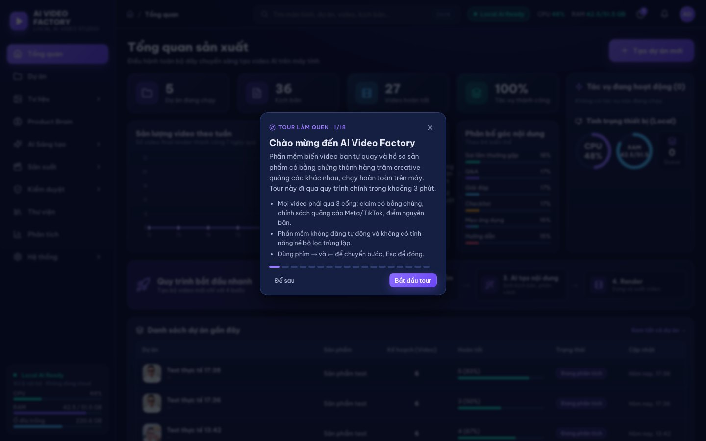

| Phím | Tác dụng |
|---|---|
| `→` hoặc `Enter` | Bước tiếp |
| `←` | Quay lại |
| `Esc` | Đóng tour |

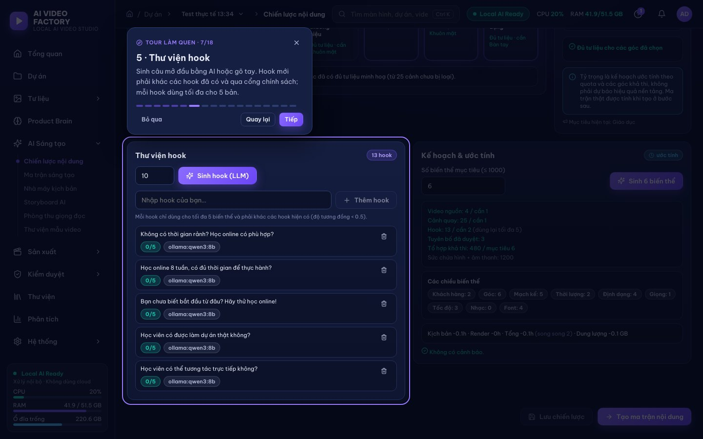

Nút **?** ở thanh trên cùng (cạnh chuông thông báo) mở menu trợ giúp bất cứ lúc nào:

- **Tour làm quen**: chạy lại toàn bộ tour.
- **Hướng dẫn màn này**: giải thích các phần chính của màn đang mở.
- **Checklist bắt đầu**: 11 bước của một vòng sản xuất, tính từ dữ liệu thật của dự án đang chọn (đã nhập video chưa, đã duyệt cảnh chưa, đã có claim có bằng chứng chưa…). Bước tiếp theo được đánh dấu "Làm tiếp"; bấm vào để tới đúng màn. Số trên nút **?** là số bước còn lại.

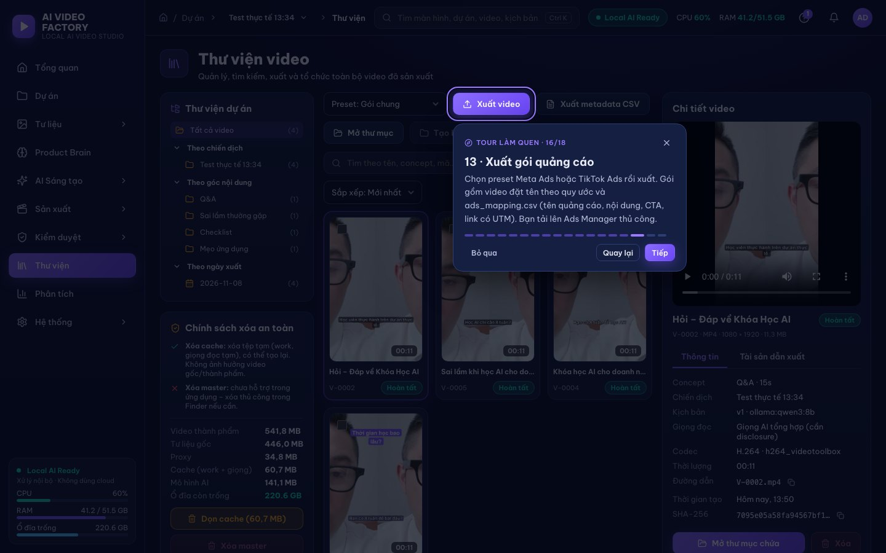

Tour chỉ tự mở một lần; trạng thái được lưu trong cài đặt của app nên không hiện lại sau khi khởi động lại.

---

## Quy trình 14 bước

Thanh bên trái của app đi theo đúng thứ tự dưới đây.

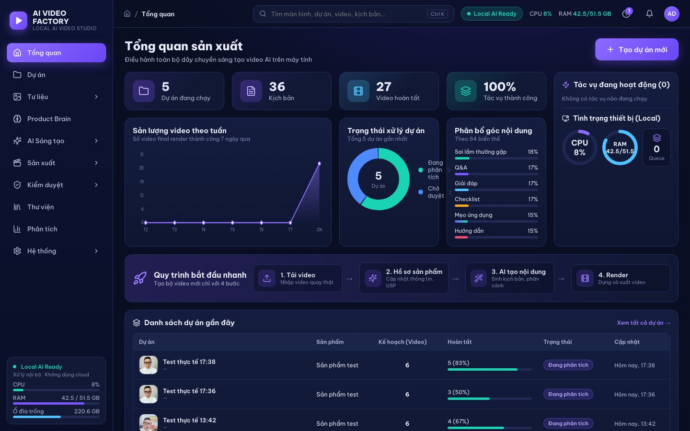

*Tổng quan: số dự án, kịch bản, video hoàn tất, phân bổ góc nội dung, tác vụ đang chạy và tình trạng máy.*

### 1. Tạo dự án

**Menu: Dự án → Dự án mới**

Một dự án gồm một sản phẩm và một chiến dịch. Nhập tên dự án, tên sản phẩm và số video mục tiêu. Đổi dự án đang làm ở thanh đường dẫn phía trên. Xoá dự án phải gõ lại tên để tránh nhầm.

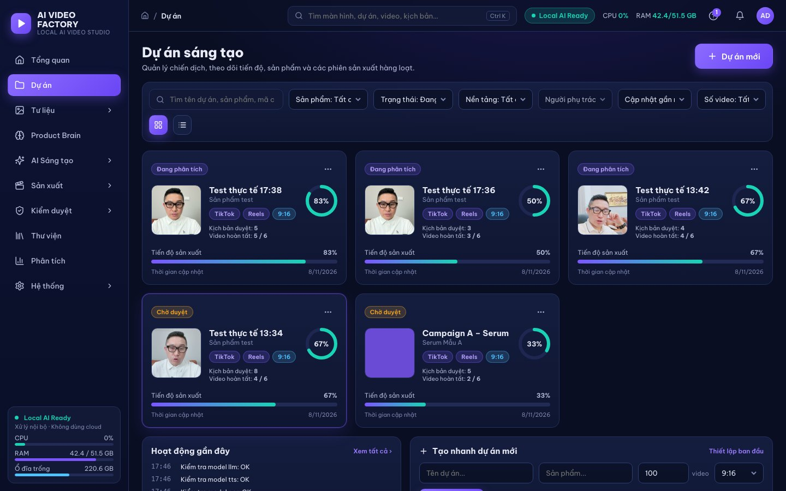

### 2. Nhập video nguồn

**Menu: Tư liệu → Nguồn video**

1. Kéo thả file vào khung **Nhập tư liệu nguồn**, hoặc bấm **Từ thư mục** để nhập cả thư mục mà không sao chép file.
2. Kiểm tra cột **Quyền sử dụng**: tư liệu không rõ quyền sẽ bị chặn ở bước QC.
3. Bật/tắt các bước phân tích ở cột phải (tách cảnh, lời thoại, OCR, chất lượng).

Phần mềm đọc thông số (độ phân giải, fps, codec, xoay màn hình), tính mã SHA-256 để chặn file trùng và tạo bản xem trước nhẹ.

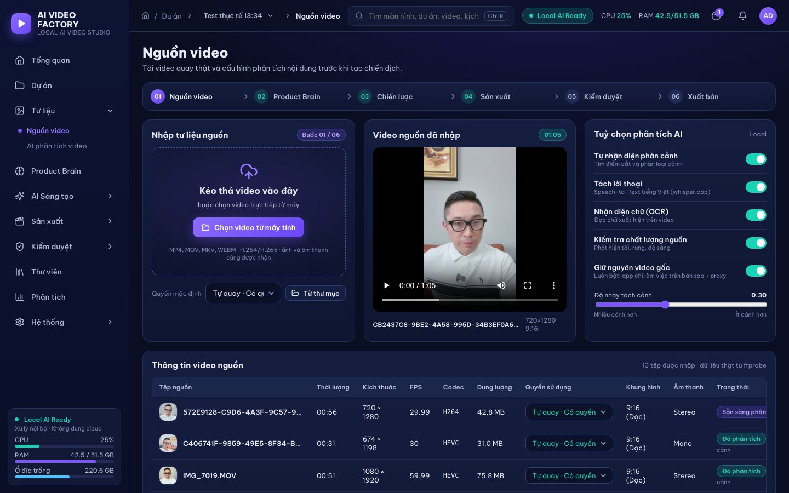

> [!IMPORTANT]
> Muốn làm nhiều bản thì cần nhiều nguồn khác góc máy, bối cảnh. Phần mềm yêu cầu: trên 20 bản cần 3 video và 12 cảnh; trên 100 bản cần 5 video và 25 cảnh; trên 300 bản cần 8 video và 40 cảnh.

### 3. Phân tích và duyệt cảnh

**Menu: Tư liệu → AI phân tích video**

- Video được tách cảnh, chấm điểm sáng/rung, đọc chữ trên hình và tách lời thoại tiếng Việt.
- Nhãn cảnh (packshot, thao tác tay, khuôn mặt…) chỉ là **gợi ý**. Bấm duyệt từng cảnh, hoặc chọn nhiều cảnh rồi **Đưa vào thư viện cảnh**.
- Bấm một dòng transcript để video nhảy tới đúng giây đó.
- Phân tích lại không làm mất các cảnh bạn đã duyệt hoặc đã khoá.

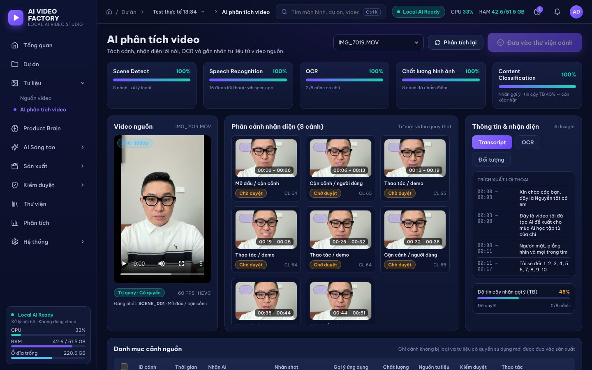

### 4. Product Brain: claim và bằng chứng

**Menu: Product Brain**

Đây là nguồn sự thật duy nhất của AI.

1. Điền USP, cách dùng, giới hạn, CTA được phép, cụm từ cấm.
2. Thêm **bằng chứng** (tài liệu, chứng nhận, kết quả kiểm nghiệm).
3. Thêm **claim** và gắn với bằng chứng. Claim không có bằng chứng không duyệt được.
4. Thêm FAQ để AI có nhiều chất liệu hơn.

Thẻ **AI Knowledge Audit** cho biết còn bao nhiêu phát ngôn chưa có bằng chứng.

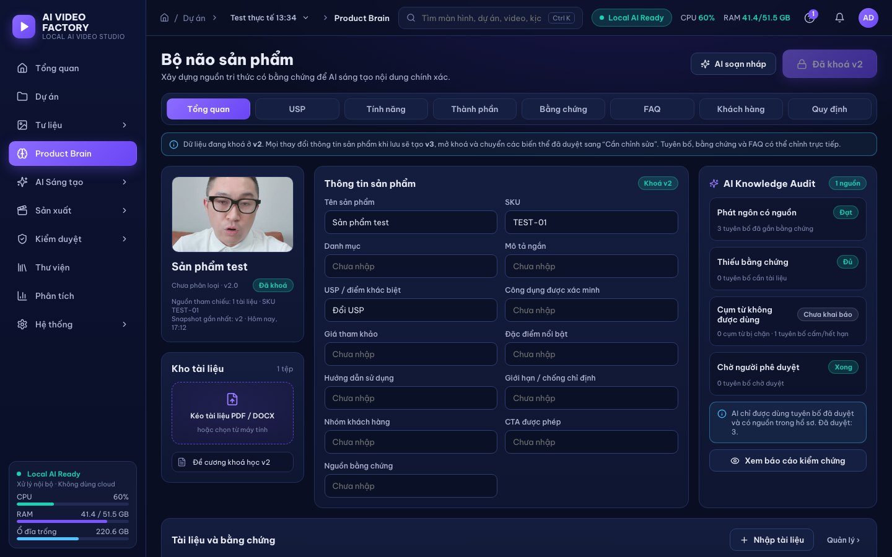

### 5. Chiến lược, thư viện hook, kế hoạch

**Menu: AI Sáng tạo → Chiến lược nội dung**

**Thiết lập chiến dịch:** chọn nhóm khách hàng, mạch kể, thời lượng, bố cục, **nền tảng** (Facebook/Instagram, TikTok), **ngành hàng** (để áp đúng bộ quy tắc chính sách) và **landing URL** (để gói xuất gắn UTM).

**Thư viện hook:** bấm **Sinh hook (LLM)** để AI viết câu mở đầu, hoặc gõ hook tay rồi **Thêm hook**. Hook mới phải khác mọi hook đã có (độ giống dưới 0,5), qua claim gate và cổng chính sách. Mỗi hook dùng cho tối đa 5 bản.

**Kế hoạch & ước tính:** nhập số bản muốn làm (tối đa 1000). Thẻ cho biết còn thiếu video nguồn, hook hay claim nào, có bao nhiêu tổ hợp khả thi, mất bao nhiêu giờ (đo từ tốc độ thật của máy bạn) và tốn bao nhiêu GB. Hết cảnh báo đỏ thì bấm **Sinh N biến thể**.

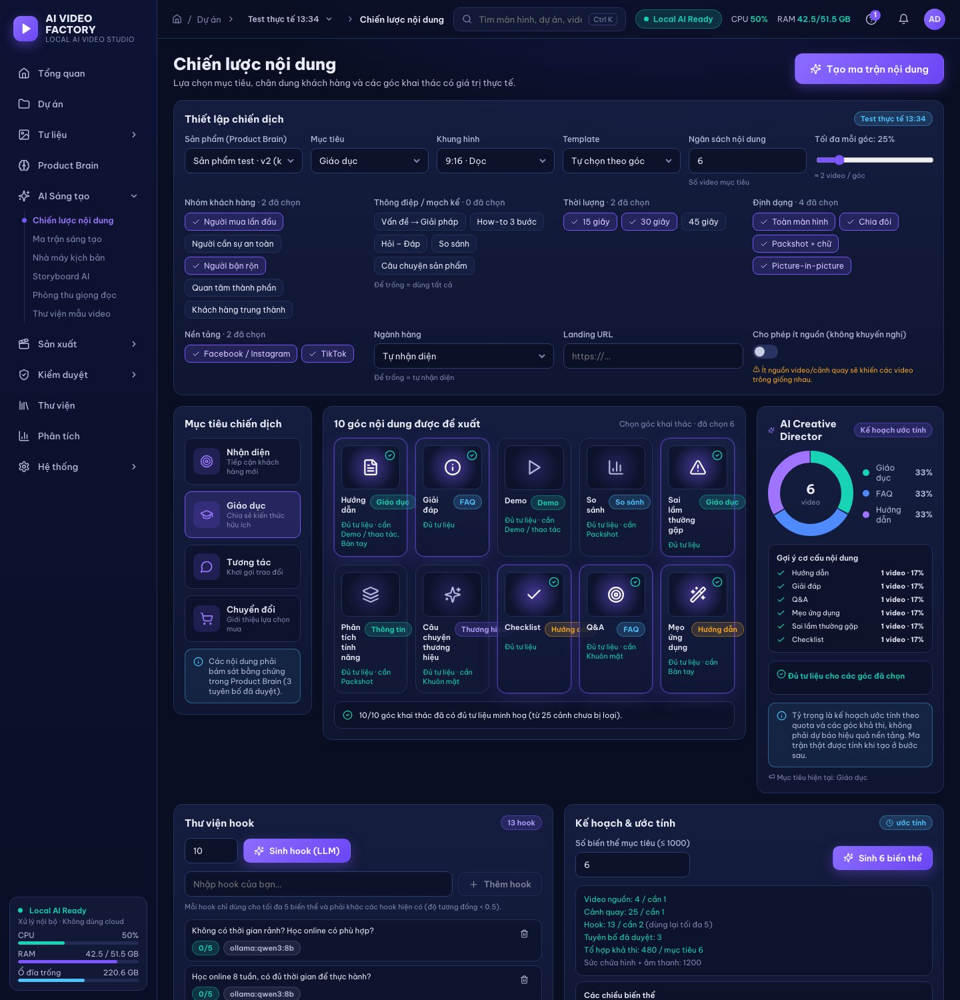

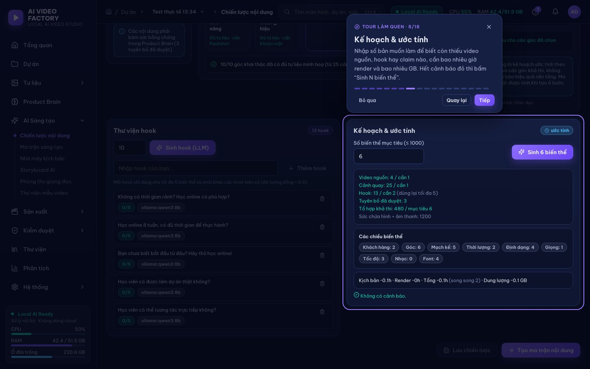

### 6. Ma trận biến thể

**Menu: AI Sáng tạo → Ma trận sáng tạo**

- Mỗi dòng là một biến thể: khán giả × góc × kết cấu × thời lượng × bố cục, kèm tốc độ giọng, font và nhạc được gán tự động.
- Cột **Lô** cho biết bản thuộc lô nào. Cột **Độc đáo** là điểm nguyên bản sau QC (đỏ là dưới ngưỡng).
- **Tạo ma trận mới**: nhập số bản; tích "Thêm thành lô mới" để giữ các bản đang có.
- **Tạo kịch bản**: đưa toàn bộ bản nháp vào hàng đợi cho AI viết.

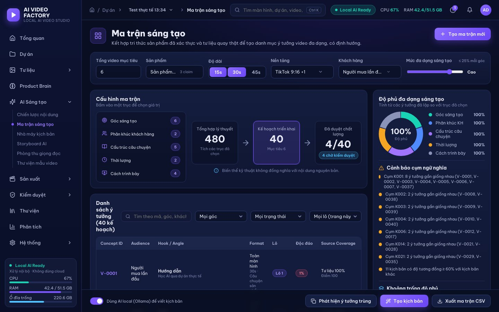

### 7. Duyệt kịch bản

**Menu: AI Sáng tạo → Nhà máy kịch bản**

Kịch bản chia theo beat (hook, thân, CTA), hook lấy từ thư viện. Cờ **đỏ** là lỗi phải sửa:

- claim chưa duyệt hoặc câu không khớp claim được trích;
- cụm từ cấm của thương hiệu;
- vi phạm chính sách quảng cáo (cam kết kết quả, trước/sau, công dụng y khoa, giảm cân theo kg, nhận xét ngoại hình người xem…).

Sửa câu bị gắn cờ trong trình soạn rồi bấm **Duyệt kịch bản**.

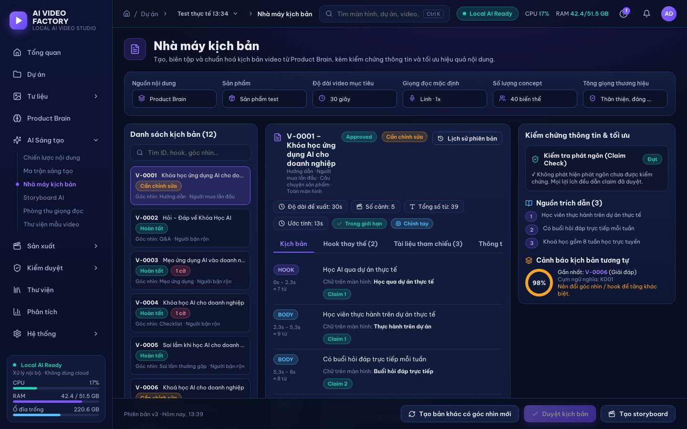

### 8. Storyboard

**Menu: AI Sáng tạo → Storyboard AI**

Mỗi câu thoại được gán một cảnh theo nhãn và điểm chất lượng, **ưu tiên cảnh chưa bản nào khác dùng** để các video không trùng hình. Bố cục chia đôi và hình-trong-hình lấy thêm một cảnh khác làm cảnh phụ. Đổi cảnh, chuyển động, thời lượng ở cột phải.

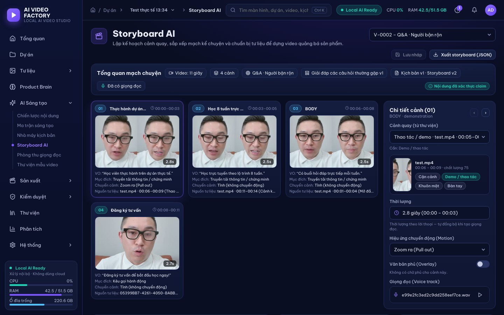

### 9. Giọng đọc

**Menu: AI Sáng tạo → Phòng thu giọng đọc**

Giọng tiếng Việt của hệ điều hành, chuẩn hoá âm lượng về −16 LUFS, có từ điển đọc số và đơn vị. Mỗi biến thể tự được gán một tốc độ (0,92 / 1,0 / 1,08). Máy có nhiều giọng tiếng Việt thì phần mềm xoay vòng giữa các giọng.

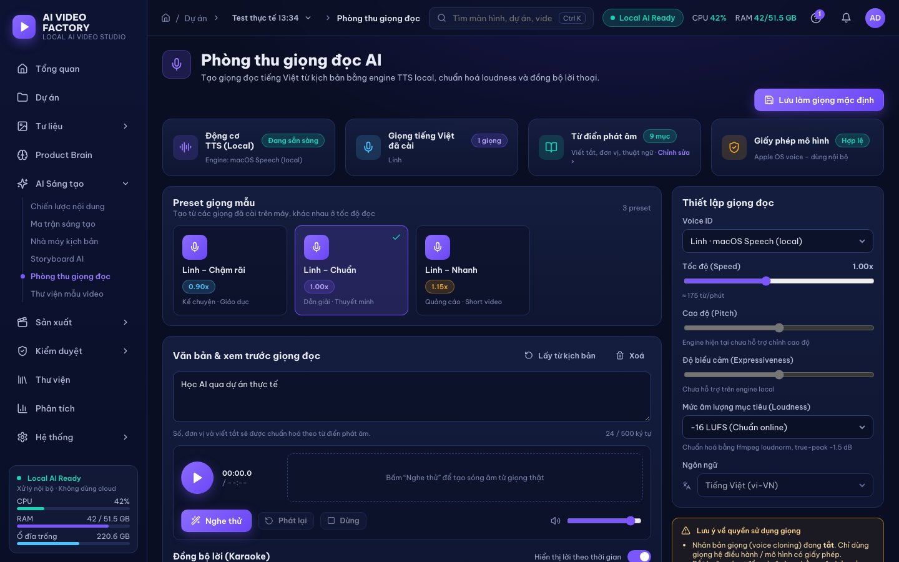

### 10. Editor và xem trước

**Menu: Sản xuất → Smart Video Editor**

Chỉnh timeline, cắt, tách, đổi cảnh, sửa phụ đề rồi **Render Preview**. Bản xem trước có chữ DRAFT và độ phân giải một nửa để render nhanh. QC tự chạy khi render xong.

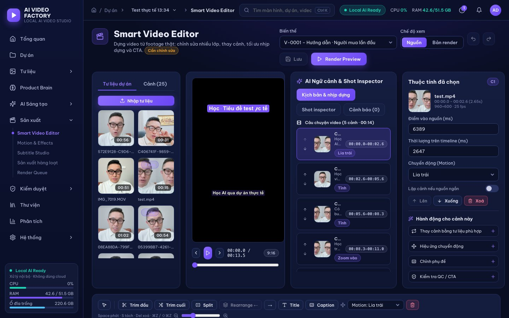

Phụ đề chỉnh sâu hơn ở **Sản xuất → Subtitle Studio**:

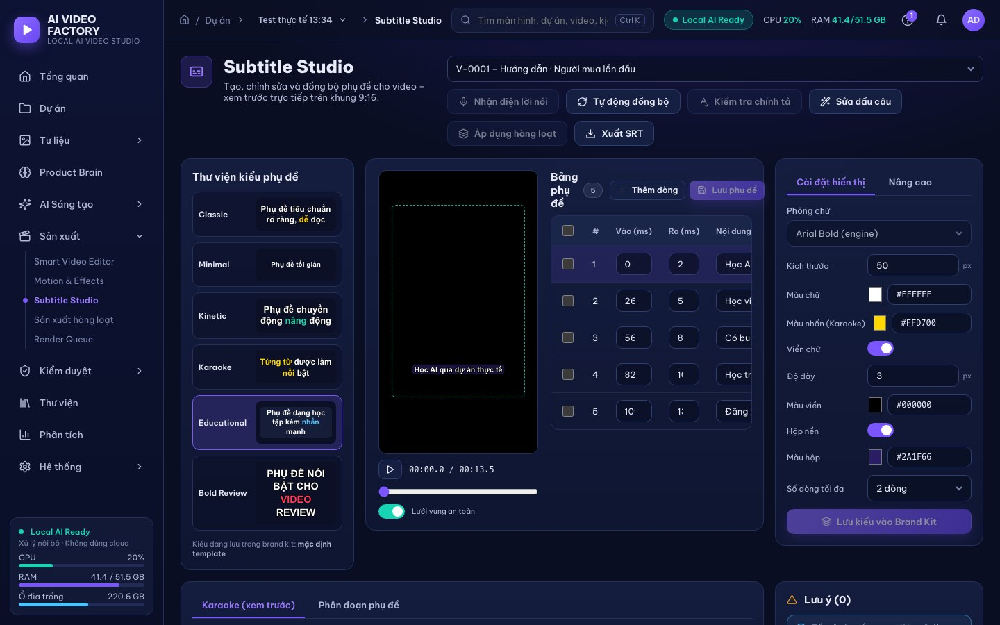

### 11. Kiểm định QC

**Menu: Kiểm duyệt → Kiểm định nội dung**

Mỗi bản xem trước có báo cáo gồm:

| Kiểm tra | Nội dung |
|---|---|
| Claim | Câu nào nói lợi ích chưa có bằng chứng |
| Chính sách quảng cáo | Vi phạm theo ngành và nền tảng, có trích quy định |
| Điểm nguyên bản | Giống bản gần nhất bao nhiêu về chữ, hook, hình, tiếng |
| Trùng cảnh | Tỷ lệ cảnh dùng chung với bản khác |
| Quyền tư liệu | Tư liệu chưa xác nhận quyền |
| Kỹ thuật | Khung đen, đứng hình, âm thanh bị clipping |
| Vùng an toàn TikTok | Chữ bị icon hoặc caption của TikTok che |
| Bản quyền nhạc | Nhạc nền chưa có file LICENSE |

Quyết định: **Duyệt**, **Yêu cầu sửa**, **Từ chối**, hoặc **Duyệt kèm lý do**. Lỗi claim, chính sách và nguyên bản **không thể** duyệt kèm lý do.

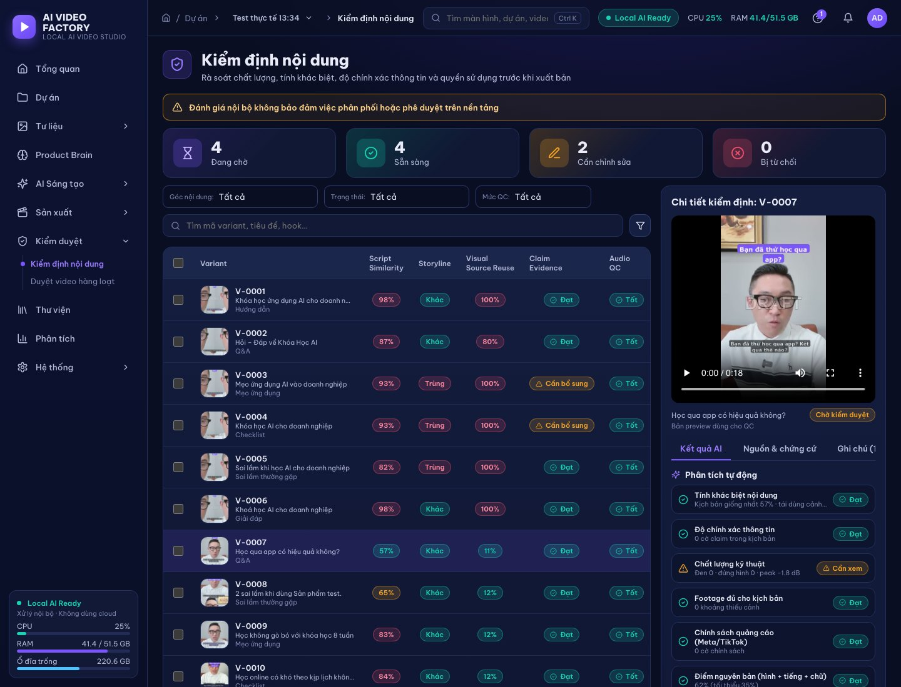

### 12. Sản xuất hàng loạt và hàng đợi

**Menu: Sản xuất → Sản xuất hàng loạt**, rồi **Render Queue**

Chọn chiến dịch, thời lượng, giọng, template, brand kit, chất lượng xuất và tạo lô render final. Chỉ bản đã duyệt QC mới vào lô; bản có điểm nguyên bản dưới ngưỡng bị loại và được liệt kê để sửa. GPU được dùng khi có (VideoToolbox trên Mac; NVENC/QSV/AMF trên Windows), tự chuyển sang CPU nếu lỗi.

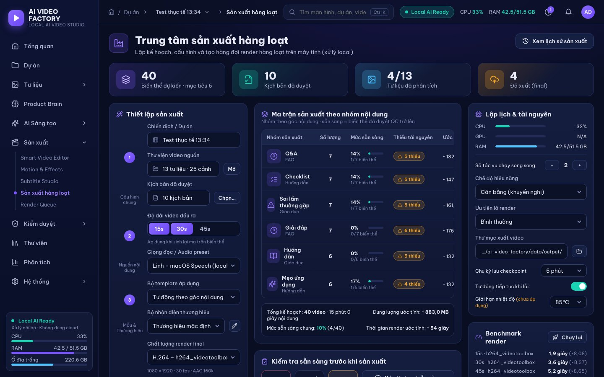

Hàng đợi lưu trong SQLite: tắt máy giữa chừng thì mở lại vẫn chạy tiếp, job treo được tự phát hiện và thử lại. Tạm dừng, tiếp tục, thử lại, huỷ từng job hoặc **cả lô** (thẻ "Lô render" cuối trang). Chế độ Eco / Balanced / Turbo điều chỉnh số job chạy song song.

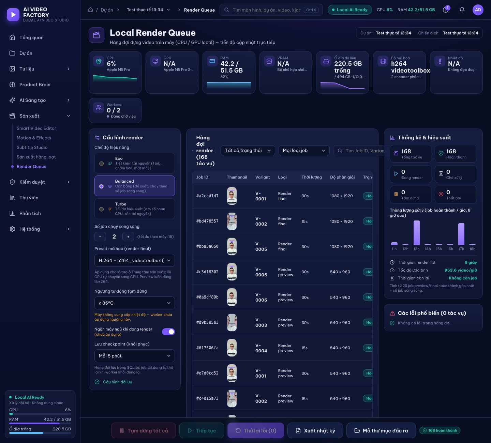

### 13. Thư viện và gói xuất cho Ads Manager

**Menu: Thư viện**

Mọi video final nằm ở đây (MP4 + phụ đề SRT + ảnh thumbnail + manifest JSON). Để xuất:

1. Chọn preset **Meta Ads** hoặc **TikTok Ads** ở ô **Preset**.
2. Bấm **Xuất video**.
3. Mở thư mục kết quả. Trong đó có:
   - video đặt tên theo quy ước `chiendich_V-0001_goc_khachhang_30s_hook.mp4`;
   - `ads_mapping.csv`: mỗi dòng một quảng cáo với tên, primary text, headline, CTA, landing URL có UTM theo mã biến thể, cột `spec_ok` cho biết video có đạt thông số của nền tảng không;
   - `README.txt` hướng dẫn tải lên.
4. Tải lên Ads Manager **thủ công**.

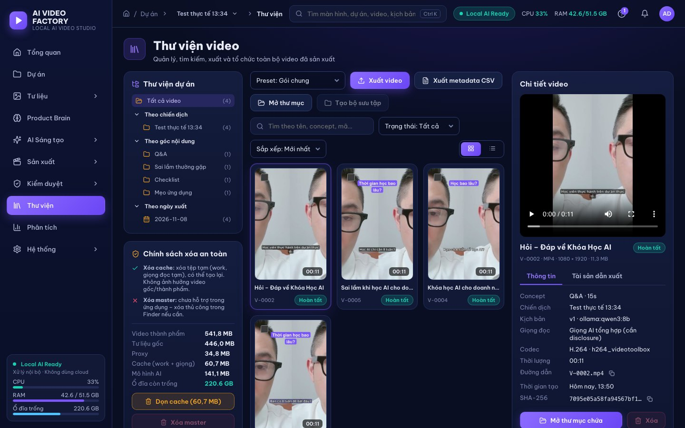

### 14. Phân tích và lô kế tiếp

**Menu: Phân tích**

1. Bấm **Tải CSV mẫu**, điền kết quả từ Ads Manager (cột `code` là mã biến thể như `V-0001`), rồi **Nhập CSV hiệu suất**.
2. Thẻ **Yếu tố thắng → lô kế tiếp** tính mức chênh (lift) của từng hook, góc, khán giả, kết cấu, bố cục, thời lượng, tốc độ giọng, nhạc theo KPI bạn chọn (CTR, giữ chân 3 giây, xem hết, lượt xem, chuyển đổi). Chỉ yếu tố có ít nhất 2 bản mới được tính là thắng.
3. Bấm **Sinh lô kế tiếp**: ma trận mới ưu tiên yếu tố thắng, hook thắng được dùng lại, một phần hook mới được sinh thêm để tiếp tục thử (chỉnh tỷ lệ ở thanh "Tỷ lệ khám phá hook mới").

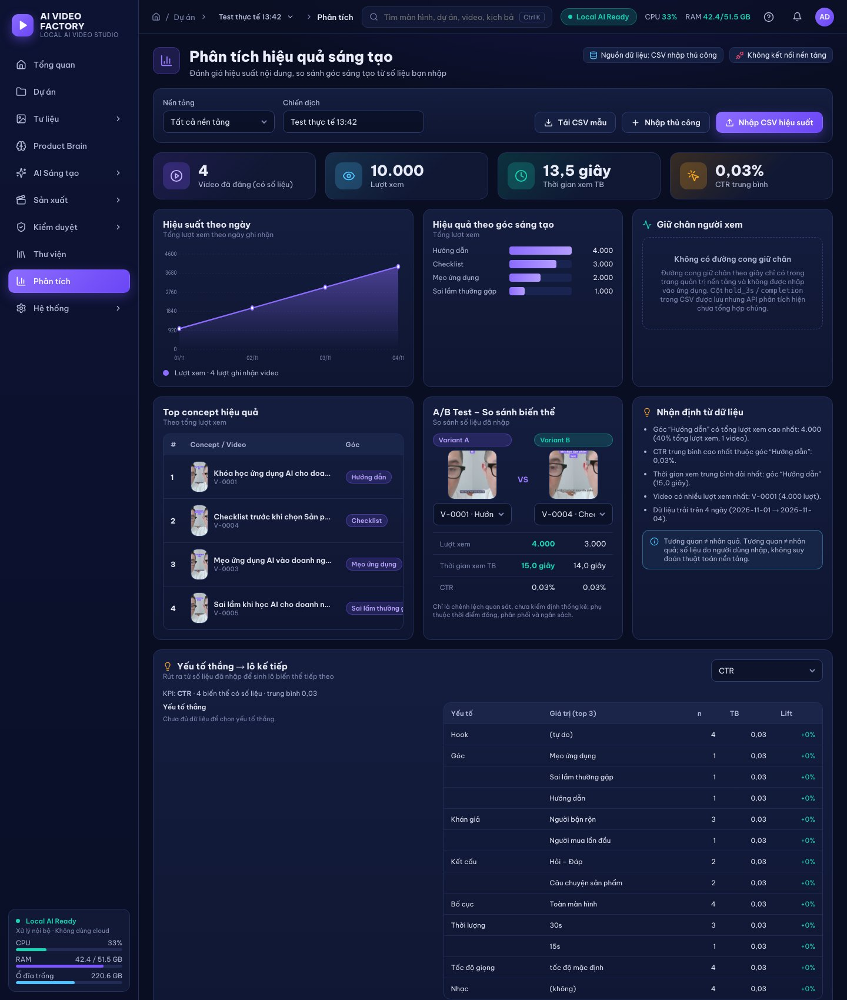

---

## Các màn hình hệ thống

### Nhận diện thương hiệu

**Menu: Hệ thống → Nhận diện thương hiệu.** Màu chủ đạo, kiểu phụ đề, từ khoá nhấn màu, **logo** (chèn góc trên trái trong vùng an toàn) và **thẻ kết** 1,8 giây (nền màu thương hiệu + logo + CTA) được áp vào video khi render.

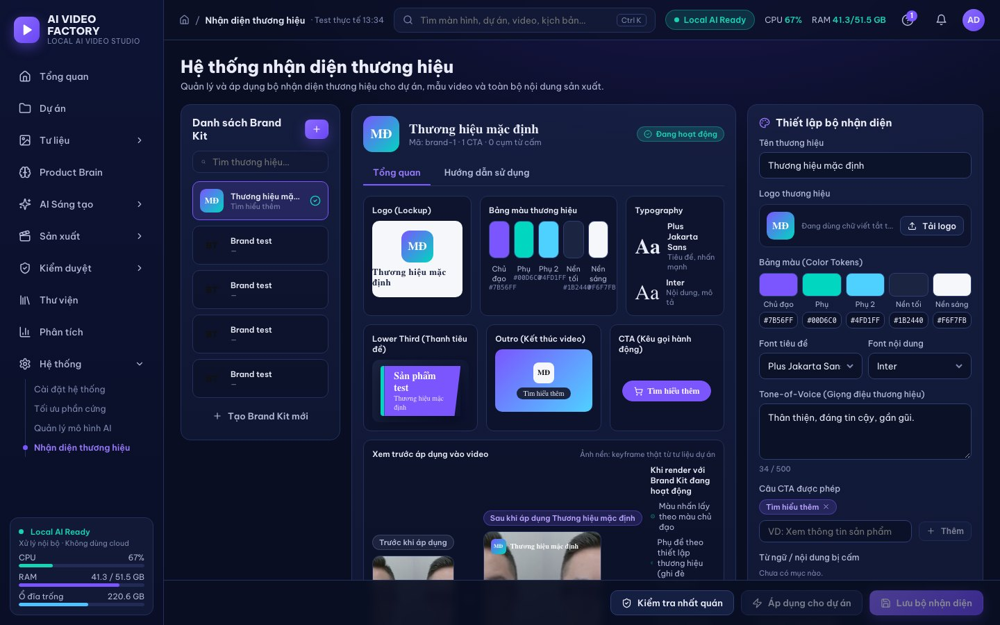

### Thư viện mẫu video

**Menu: AI Sáng tạo → Thư viện mẫu video.** Mẫu quy định cấu trúc, kiểu phụ đề, chuyển động. Ma trận tự chọn mẫu theo góc nội dung.

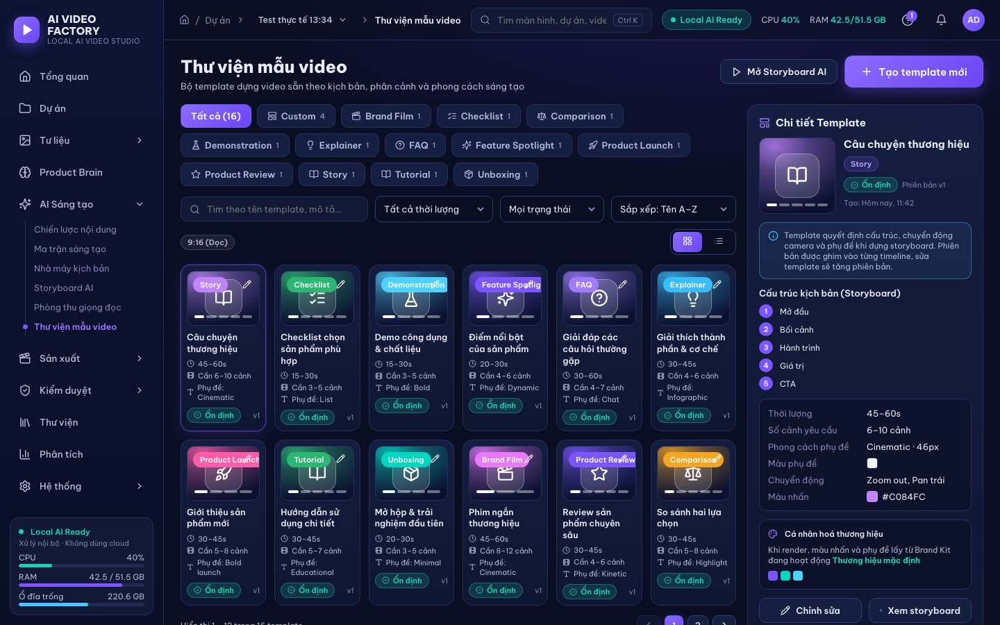

### Quản lý mô hình AI

**Menu: Hệ thống → Quản lý mô hình AI.** Engine nào đã cài: LLM, tách lời thoại, giọng đọc, OCR, embedding, vision. Model Whisper tải bằng một nút từ nguồn đã duyệt.

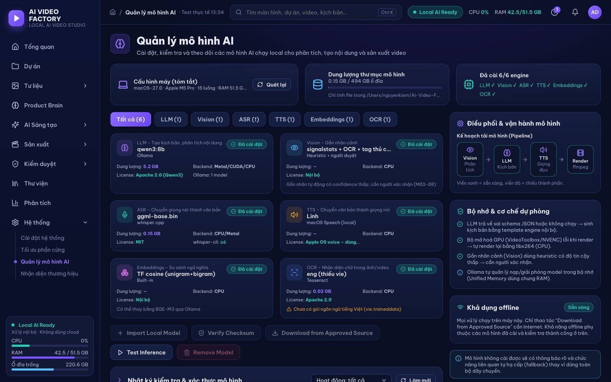

### Tối ưu phần cứng

**Menu: Hệ thống → Tối ưu phần cứng.** Benchmark tốc độ render trên máy và gợi ý chế độ chạy.

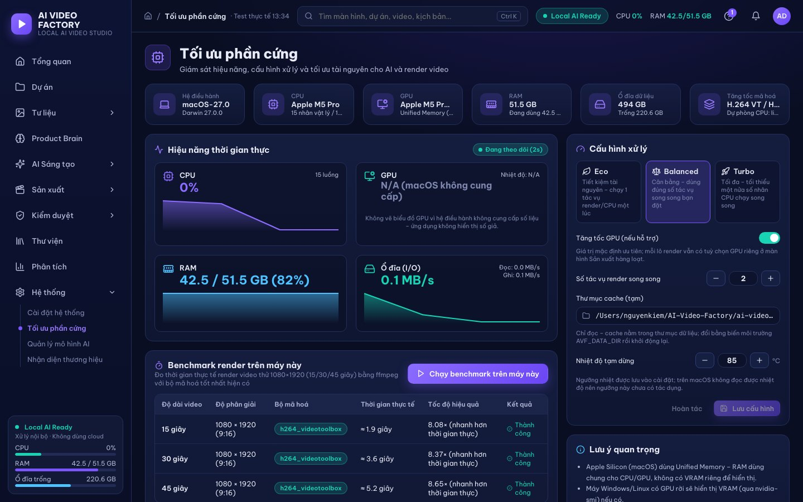

### Cài đặt hệ thống

**Menu: Hệ thống → Cài đặt hệ thống.** Số job song song, GPU, âm lượng mục tiêu, **ngưỡng điểm nguyên bản** (mặc định 0,35), các kiểm tra QC, sao lưu dữ liệu. Thẻ **Thành phần & phụ thuộc** dùng để kiểm tra môi trường khi cài máy mới.

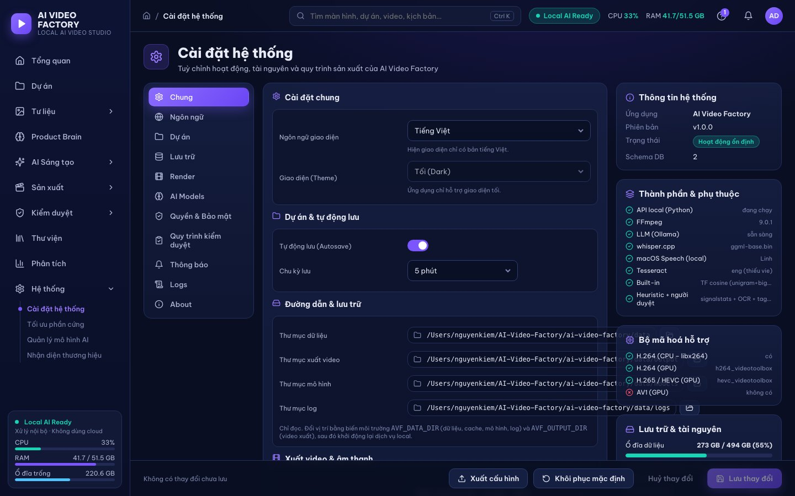

---

## Các cổng an toàn và cách xử lý khi bị chặn

| Mã lỗi | Cổng | Khi nào | Cách xử lý |
|---|---|---|---|
| `BLOCK-01` | Claim gate | Câu nói lợi ích chưa có bằng chứng, hoặc không khớp claim được trích | Thêm bằng chứng cho claim ở Product Brain, hoặc sửa câu |
| `BLOCK-05` | Chính sách quảng cáo | Câu vi phạm chính sách Meta/TikTok | Bỏ câu trước/sau, cam kết kết quả, công dụng y khoa, giảm cân theo kg, nhận xét ngoại hình người xem |
| `BLOCK-04` | Điểm nguyên bản | Bản quá giống một bản khác trong chiến dịch | Đổi hook, dựng lại storyboard (cảnh khác sẽ được ưu tiên), đổi bố cục hoặc tốc độ giọng, chạy QC lại |
| `BLOCK-02` | Quyền tư liệu | Tư liệu chưa xác nhận quyền sử dụng | Xác nhận quyền ở màn Nguồn video |
| `NEED_MORE_SOURCE` | Cổng nguồn | Số bản mục tiêu lớn so với số video/cảnh | Quay thêm clip khác góc máy, nhập và duyệt cảnh |
| Cảnh báo | Vùng an toàn TikTok | Chữ chạm vùng icon/caption của TikTok | Phần mềm tự thu chữ; nếu vẫn chạm, rút ngắn câu |
| Cảnh báo | Bản quyền nhạc | Nhạc nền không kèm LICENSE | Đặt `LICENSE.txt` trong `data/music` |
| Luôn nhắc | Nhãn AI | Video có giọng AI tổng hợp | Bật nhãn "nội dung do AI tạo" khi đăng; manifest ghi sẵn |

---

## Bố cục video

Bốn bố cục được gán xoay vòng theo biến thể. Cảnh phụ trong "chia đôi" và "hình-trong-hình" luôn là **một cảnh khác**, không phải bản lặp hay lật của cảnh chính.

| Chia đôi | Hình-trong-hình | Panel chữ | Thẻ kết thương hiệu |
|---|---|---|---|
| 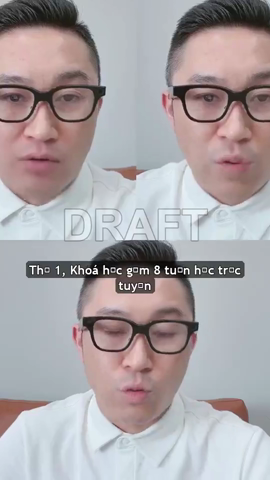 | 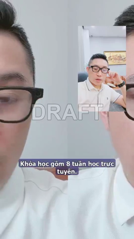 | 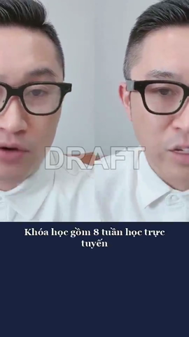 |  |

*Khung hình lấy từ bản xem trước (có chữ DRAFT). Bản final không có watermark, độ phân giải 1080×1920.*

---

## Làm 100–1000 bản: chuẩn bị gì

| Số bản | Video nguồn | Cảnh đã duyệt | Claim có bằng chứng | Hook |
|---|---|---|---|---|
| ≤ 20 | 1 | 1 | 2–3 | 4 |
| 21–100 | 3 | 12 | 3–4 | 20 |
| 101–300 | 5 | 25 | 5 | 60 |
| 301–1000 | 8 | 40 | 5+ | 200 |

Thêm vào đó, để các bản khác nhau rõ hơn:

- cài thêm giọng đọc tiếng Việt cho hệ điều hành (phần mềm tự xoay vòng);
- đặt nhạc có bản quyền vào `data/music` kèm `LICENSE.txt`;
- thêm FAQ cho sản phẩm.

Thẻ **Kế hoạch & ước tính** ở màn Chiến lược tính chính xác cho dự án của bạn trước khi sinh.

---

## Câu hỏi thường gặp

**Sinh ma trận báo "cần thêm nguồn"?**
Số bản mục tiêu vượt mức nguồn hiện có (xem bảng trên). Quay thêm clip khác góc, nhập và duyệt cảnh. Nếu buộc phải bỏ qua, bật "Cho phép ít nguồn" ở Chiến lược; kế hoạch sẽ ghi cảnh báo.

**QC báo BLOCK-04 dù kịch bản khác nhau?**
Điểm nguyên bản tính cả hình và tiếng. Hai bản khác kịch bản nhưng cùng cảnh, cùng bố cục, cùng tốc độ giọng vẫn giống nhau về mặt video. Dựng lại storyboard, đổi bố cục hoặc tốc độ giọng rồi QC lại.

**Kịch bản AI viết bị khoá (cờ đỏ)?**
Mở kịch bản, xem câu bị gắn cờ và lý do. Thường là câu nói lợi ích mà claim chưa có bằng chứng, hoặc câu vi phạm chính sách. Sửa câu hoặc bổ sung bằng chứng ở Product Brain.

**Muốn xem lại hướng dẫn?**
Bấm nút **?** ở thanh trên cùng → **Tour làm quen** hoặc **Hướng dẫn màn này**.

**Có thể đăng tự động không?**
Không. Gói xuất dùng để tải lên Ads Manager thủ công. Cách đăng tự động hợp lệ duy nhất là TikTok Content Posting API và Meta Graph API với tài khoản bạn sở hữu và ứng dụng developer được duyệt; phần mềm chưa tích hợp.

**Chụp lại ảnh tài liệu sau khi giao diện thay đổi?**

```bash
.venv/bin/python -I scripts/capture_screens.py --project <id-dự-án> [--analytics-project <id>] [--asset <id>] [--qc-variant <id>]
```

Cần API đang chạy ở 127.0.0.1:8765 với bản build giao diện. Script dùng Chrome hoặc Edge headless.

---

## Giới hạn hiện tại

- Bộ quy tắc chính sách dựa trên tài liệu công bố đến 2025. Nó chặn sớm các câu chắc chắn bị từ chối, nhưng không thay kiểm duyệt của Meta/TikTok và không bảo đảm quảng cáo được duyệt.
- Điểm nguyên bản so sánh cảnh, bố cục, font, giọng, nhạc và chữ; chưa dùng so khớp khung hình hay embedding ngữ nghĩa.
- Chuyển động khi render chỉ có zoom và pan. Watermark và lower third của Brand Kit chưa được chèn khi render.
- Video ngang đưa về khung dọc bị cắt lấy phần giữa; chưa bám theo khuôn mặt.
- Windows chưa được chạy thử trên máy thật.
- Không có và sẽ không có: tự đăng, quản lý nhiều tài khoản, đổi proxy, né bộ lọc trùng lặp.
